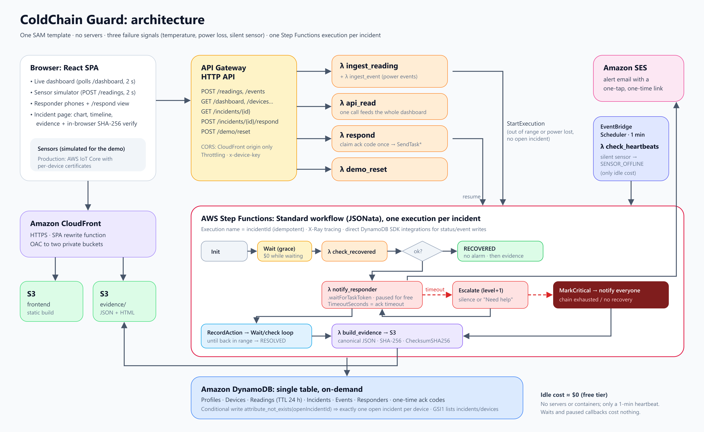

# ColdChain Guard

**A serverless watchdog for medicines and samples that must stay cold.** When a fridge drifts out of its safe range,
loses power, or its sensor goes silent, a Step Functions workflow waits a smart grace period (no false alarms), alerts a person, escalates when nobody answers,
and seals a SHA-256-fingerprinted evidence report. While every fridge is fine, it costs (almost) nothing.



| | |
|---|---|
| **Backend** | One AWS SAM template: API Gateway HTTP API, 9 Python 3.12 Lambdas, EventBridge Scheduler, Step Functions (Standard, JSONata), DynamoDB (on-demand, single table), S3, SES, CloudFront |
| **Frontend** | React 18, Vite, TypeScript, Tailwind CSS, Recharts, lucide-react, Inter (bundled locally) |
| **No** | servers, containers, provisioned capacity or CI/CD pipeline. Deploy is `sam deploy` + `aws s3 sync`, by design |

---

## Deploy your own copy (about 10 minutes)

### Prerequisites
- An AWS account and the [AWS CLI](https://docs.aws.amazon.com/cli/latest/userguide/getting-started-install.html), configured (`aws configure`)
- [AWS SAM CLI](https://docs.aws.amazon.com/serverless-application-model/latest/developerguide/install-sam-cli.html)
- Python 3.10+ with `pip install boto3` (for the seed script), Node.js 18+
- Optional: an [AWS Budget alert](https://console.aws.amazon.com/billing/home#/budgets) at $5 as a safety net

### 1. Backend

```bash
# A random key that sensors (and the demo simulator) send in the x-device-key header
DEVICE_KEY=$(python -c "import secrets; print(secrets.token_urlsafe(24))")
echo "$DEVICE_KEY"   # keep it, you need it for the frontend deploy

sam build            # needs Python 3.12 on PATH, or use: sam build --use-container
sam deploy --guided  # first time (accept the defaults in samconfig.toml); later just: sam deploy
```

`sam deploy --guided` asks for the parameters. Or pass them directly:

```bash
sam deploy --parameter-overrides TimeScale=45 DemoMode=true SenderEmail=you@example.com DeviceApiKey=$DEVICE_KEY
```

> **No Python 3.12 locally?** The Lambdas have **no third-party dependencies**, so you can skip `sam build` and run
> `sam deploy` straight from the source tree. SAM zips `src/` as-is. (This is how the hackathon stack was deployed.)

| Parameter | Default | Meaning |
|---|---|---|
| `TimeScale` | `1` (samconfig: `45`) | Divides every grace / acknowledgement / recheck timer. At 45, a 15-minute grace becomes 20 s for demos. Use `1` in production. |
| `DemoMode` | `true` | Enables `POST /demo/reset` and lets the on-screen "responder phones" see pending ack codes. Set `false` in production. |
| `SenderEmail` | *(empty)* | SES-verified sender. Empty = in-app alerts only. |
| `HeartbeatSchedule` | `rate(1 minute)` | How often to look for silent sensors. |
| `DeviceApiKey` | *(required)* | Shared sensor key (production: AWS IoT Core with per-device certificates). |

### 2. Seed profiles, devices and responders

```bash
python seed/seed.py --stack coldchain-guard --region us-east-1 \
  --email nurse-on-duty=you+nurse@example.com \
  --email facility-manager=you+manager@example.com \
  --email district-pharmacist=you+pharmacist@example.com
```

**SES sandbox:** verify the sender and every recipient address in the SES console (*Identities → Create identity*)
before the demo. Sandbox mode is fine. Without emails, alerts still appear in the app's responder phones.

### 3. Frontend

```bash
DEVICE_KEY=<your key> ./scripts/deploy_frontend.sh                       # macOS / Linux / Git Bash
$env:DEVICE_KEY = "<your key>"; .\scripts\deploy_frontend.ps1           # Windows PowerShell
```

The script builds the app, writes `config.json` (API URL and device key) from the stack outputs, syncs to S3 and
invalidates CloudFront. The same build works for any stack, with no rebuild per environment. Open the `CloudFrontUrl`
output.

### Local frontend development

```bash
cd frontend && cp .env.example .env.local   # fill in API URL, device key, CloudFront URL
npm install && npm run dev                   # http://localhost:5173 (allowed by the API's CORS)
```

### Teardown

```bash
aws s3 rm s3://<FrontendBucket> --recursive
aws s3api delete-objects --bucket <EvidenceBucket> --delete "$(aws s3api list-object-versions --bucket <EvidenceBucket> --query '{Objects: Versions[].{Key:Key,VersionId:VersionId}}')"
sam delete
```
(The evidence bucket is versioned, so delete object versions too. Or empty both buckets in the S3 console.)

---

## Try the demo

1. Open the dashboard. All four devices are green. *No workflow is running.*
2. **Door open (brief)** on *Insulin at home*: the line spikes red, the device goes amber **Grace period**, recovers,
   and the incident closes as **Recovered · no alarm**.
3. **Power cut** on *Blood bank*: the line climbs through the red band → **Grace** → **Alerting**. Nurse Thandi's
   phone rings. Ignore it, and after the ack timeout it **escalates** to Manager Pieter.
   (The card shows **On battery**: the `POWER_LOST` early warning opens the incident *before* the temperature leaves range.)
4. On the manager's phone tap **Moved to backup cooler**, then **Restore** in the simulator (power restored). The line
   returns to the green band, then **Resolved** and **Evidence sealed**.
4b. **Sensor goes silent** on *Vaccine fridge*: within about a minute the card greys out ("Silent for …") and a
   `SENSOR_OFFLINE` incident alerts the nurse. **Restore** resumes readings and re-checks the temperature.
5. Open the incident: chart, timeline, escalation ladder, SHA-256 fingerprint → **Verify** → ✅ Match.
6. **Reset demo** (simulator panel) cancels running workflows and clears readings.

---

## How it works

### How does AWS know the fridge has a problem?

AWS can't see the fridge, so **a sensor at the fridge has to tell it.** In production that sensor is a temperature probe on a small
battery-backed device (an ESP32 or a commercial logger) on Wi-Fi or a SIM card, publishing to **AWS IoT Core** over
MQTT with its own X.509 certificate. An IoT Rule calls the same Lambdas. **In this build the sensors are simulated in
the browser** and post to API Gateway with an `x-device-key` header. Only the front door differs; the logic is the same.

| # | Signal | Detected by | Example cause | Incident type |
|---|---|---|---|---|
| 1 | Temperature out of range | `ingest_reading` compares each reading with the profile | Compressor died, door left open | `TEMP_EXCURSION` |
| 2 | Power lost (sensor on battery) | `POST /events` → `ingest_event`. **Early warning before the fridge warms** | Power cut, plug pulled, tripped breaker | `POWER_LOST` |
| 3 | Sensor silent | `check_heartbeats` (EventBridge Scheduler, every minute) finds `lastSeen` older than `offlineAfterSeconds` | Wi-Fi down in the outage, battery dead, sensor removed | `SENSOR_OFFLINE` |

All three feed **the same Step Functions workflow**, and a device only ever has **one** open incident. Later signals
are added to its timeline. The one thing that runs while everything is healthy is the once-a-minute heartbeat check
(~43,000 tiny invocations a month, inside the Lambda free tier). Silence can only be detected by something that
checks, so that's the minimum possible idle cost.


```
reading ─► POST /readings ─► λ ingest_reading ─► DynamoDB
                                   │ out of range & no open incident
                                   │ (conditional write: exactly one incident per device)
                                   ▼
            Step Functions execution (name = incidentId)
            Init → Wait(grace) → check_recovered ─ recovered ─► CloseRecovered (no alarm) ─► BuildEvidence
                                      │ still out
                                      ▼
            NotifyResponder (.waitForTaskToken, TimeoutSeconds = ack timeout)  ◄──────┐
               │ tapped "Moved"/"Fixed"            │ States.Timeout or "NeedHelp"     │
               ▼                                   ▼                                  │
            RecordAction → Wait/check loop       Escalate (level+1) ── more? ─────────┘
               │ back in range                      │ no
               ▼                                    ▼
            MarkResolved ─► BuildEvidence      MarkCritical → notify everyone ─► BuildEvidence
```

- **Grace period = a Wait state.** A durable timer that costs nothing while waiting. Door openings never alarm.
- **Silence becomes escalation.** `lambda:invoke.waitForTaskToken` pauses the workflow for free. `TimeoutSeconds`
  turns "nobody answered" into a `States.Timeout` that the workflow catches and escalates. "Need help" is a
  `SendTaskFailure("NeedHelp")` caught the same way.
- **Task tokens never leave the backend.** The token is stored under a random 256-bit `ackCode`. Only that code goes in
  links, and it is claimed exactly once with a conditional write. A second tap shows "already handled", and a link
  whose step timed out shows "expired".
- **Fewer Lambdas.** Every status change and event write is a direct DynamoDB `TransactWriteItems` SDK integration
  from the state machine (atomic incident + device + event).
- **Evidence.** `build_evidence` writes canonical JSON + a readable HTML report to S3, stores the SHA-256 on the
  incident, and S3 verifies the upload against the same checksum. The UI re-hashes the file in the browser (Web Crypto).

### Profiles: the reusable heart

A profile is data (`seed/profiles.json`): range (min-only, max-only or both), grace, ack timeout, recovery window and
escalation chain. Six are seeded: vaccine fridge, blood bank, plasma freezer, insulin at home, lab specimens and donor
breast milk. Adding a use case needs **no code**. The pattern (*threshold → grace → human ack → escalate on silence →
evidence*) fits server rooms, food storage, incubators and greenhouses too.

> ⚠️ Temperature ranges are **configurable examples, not medical advice**. Verify them against official guidance
> (WHO, national health department, blood service, manufacturer).

### API

| Method | Path | Purpose |
|---|---|---|
| POST | `/readings` | `{deviceId, tempC, batteryPct?, ts?}` + `x-device-key` header |
| POST | `/events` | `{deviceId, type: POWER_LOST \| POWER_RESTORED, batteryPct?, ts?}` + `x-device-key` |
| GET | `/dashboard?since=` | Everything the dashboard needs in one call (devices, incremental readings, incidents, events) |
| GET | `/devices`, `/devices/{id}/readings?minutes=10`, `/incidents?limit=20`, `/incidents/{id}`, `/profiles`, `/responders`, `/config` | Read API |
| POST | `/incidents/{id}/respond` | `{ackCode, action: MOVED_TO_BACKUP \| FIXED \| NEED_HELP, note?}` |
| POST | `/demo/reset` | Demo only (`DemoMode=true`, needs the device key) |

### Repository layout

```
template.yaml               all infrastructure (SAM)
statemachine/incident.asl.json   the workflow (JSONata)
src/<function>/app.py       9 Lambdas (incl. ingest_event, check_heartbeats); src/shared/ = rules, validation, DynamoDB helpers, logger
seed/                       profiles, devices, responders + seed.py
frontend/                   React app
scripts/                    deploy_frontend.sh / .ps1, simulate.py (CLI sensor)
tests/                      pytest: rules, time scaling, validation, evidence, state machine, moto end-to-end
docs/                       architecture diagram, write-up, video script
```

### Tests

```bash
python -m pytest -q                                            # pure unit tests, no dependencies
pip install boto3 "moto[dynamodb,s3,stepfunctions]" && python -m pytest -q   # + end-to-end Lambda flow on mocked AWS
```

### Security notes
- Least-privilege IAM per function (SAM policy templates plus scoped statements). `SendTaskSuccess/Failure` must be
  `Resource: "*"` because callbacks aren't resource-scoped; the one-time ack code is the capability.
- Private S3 buckets behind CloudFront Origin Access Control; CORS restricted to the CloudFront origin + localhost.
- API throttling; input validation (device id format, -90…60 °C, timestamps no more than 2 minutes ahead or 1 hour back).
- Structured JSON logs with `incidentId` on every line; X-Ray tracing; Step Functions error logging.
- The browser simulator and on-screen phones are demo aids. In production set `DemoMode=false`, use IoT Core device
  certificates instead of the shared key, and deliver ack links only by email/SMS.
