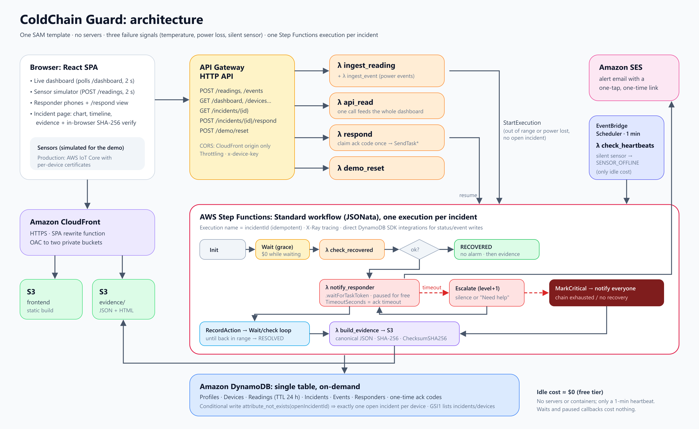

# ColdChain Guard: a serverless watchdog that saves medicines when the fridge fails

> Draft for the AWS Builder Center article. Replace every `TODO` before publishing (video link, screenshots, real cost numbers from your deploy).

**Demo video:** TODO (YouTube, public, under 3 minutes)
**Live app:** https://d2wcjncrzc05nu.cloudfront.net  ·  **Code:** TODO (repository link)

Tags: `#serverless` `#aws-step-functions` `#aws-lambda` `#amazon-dynamodb` `#aws-sam` `#healthcare`

---

## 1. The problem

*It's 2 a.m. The power goes out at a clinic. By morning, a fridge full of vaccines is warm, and nobody knows for how long.*

Vaccines, blood, insulin, lab samples and donor breast milk must stay inside a narrow temperature range. Outside it
they lose potency or become unsafe. Fridges fail **silently**: a power cut at night, a door left open, a compressor
dying on a weekend. Existing alarms are either **too noisy** (they beep at every 30-second door opening, so people stop
listening) or **too quiet** (a local beep in an empty room). Afterwards, staff must answer *"is this stock still
safe?"*, and there is rarely a reliable record of **how long** it was out of range and **who did what**.

In South Africa, where I live, scheduled power cuts make this an everyday risk. The same problem exists in every
clinic, pharmacy, blood bank, lab and home fridge worldwide.

## 2. What ColdChain Guard does

TODO: dashboard screenshot

- **Watches three failure signals:** temperature out of range, **power lost** (the sensor is on battery, an early
  warning before anything warms up) and a **silent sensor**. The safe range is drawn live as a green band.
- **Doesn't cry wolf.** When a reading goes out of range it waits a per-profile **grace period**. If the temperature
  recovers (a door opening), the incident closes quietly with **no alarm**.
- **Gets a human to act.** If it hasn't recovered, the first responder gets an alert with one-tap actions: *Moved
  to backup cooler*, *Fixed (door/power)*, *Need help*.
- **Escalates on silence.** No answer before the timeout → the next person (nurse → manager → pharmacist), then
  `CRITICAL` with everyone alerted.
- **Keeps tamper-evident proof.** Every incident ends with an evidence report (time out of range, min/max, who was
  alerted, who acted, full timeline) fingerprinted with **SHA-256**, so a pharmacist can make the use-or-discard call.

## 2b. How AWS knows something is wrong

AWS can't see the fridge, so **a sensor has to tell it.** The production design is a temperature probe on a small
**battery-backed** device (an ESP32 or a commercial logger). It detects mains loss and connects by Wi-Fi or a **SIM
card**, which keeps working when the building's router dies. It publishes to **AWS IoT Core** over MQTT with its own
X.509 certificate, so readings can't be faked. An IoT Rule invokes the same Lambdas.
**This hackathon build uses simulated sensors** in the browser that post to API Gateway with a device key. Only the
front door differs, and the detection logic is identical.

| # | Signal | How it's detected | Example cause | Incident type |
|---|---|---|---|---|
| 1 | Temperature out of range | `ingest_reading` compares every reading with the profile's min/max | Compressor died, door left open | `TEMP_EXCURSION` |
| 2 | Power lost | The sensor sends `POWER_LOST` the moment mains drops. **Early warning before the fridge warms** | Power cut, plug pulled | `POWER_LOST` |
| 3 | Sensor silent | `check_heartbeats` runs every minute (EventBridge Scheduler) and flags devices whose last reading is older than `offlineAfterSeconds` | The outage took down Wi-Fi, battery dead, sensor removed | `SENSOR_OFFLINE` |

All three start **the same Step Functions workflow**, with type-specific grace and recovery rules (power loss
recovers only when mains is back **and** the temperature is in range). A conditional write guarantees **one open
incident per device**, so a power cut that later becomes a temperature excursion is one incident with one timeline.

## 3. Architecture

**One reading's journey:**
1. A sensor (simulated in the browser for the demo) `POST`s `/readings` to **API Gateway**.
2. **Lambda `ingest_reading`** validates it, updates the device, stores the reading in **DynamoDB** (TTL 24 h) and
   evaluates the device's profile rule.
3. Out of range with no open incident → one **conditional write** (`attribute_not_exists(openIncidentId)`) opens the
   incident atomically, then **Step Functions `StartExecution`** with the incidentId as the execution name. Two racing
   readings can never create two incidents.
4. The workflow **waits** through the grace period (a Wait state, free while waiting), then **checks** the latest
   reading. Recovered → close quietly.
5. Still out → **`notify_responder`** runs as `.waitForTaskToken`. It stores the task token under a random one-time
   `ackCode`, emails a link through **SES** and lights up the responder's phone in the UI. The workflow is now
   **paused at zero cost**.
6. The responder taps an action → **Lambda `respond`** claims the code once and calls `SendTaskSuccess`. Silence →
   `TimeoutSeconds` raises `States.Timeout` → **Escalate**. "Need help" → `SendTaskFailure("NeedHelp")` → Escalate.
7. After an action, a Wait/check loop confirms the fridge is back in range → **Resolved**. Otherwise → **Critical**.
8. **`build_evidence`** writes canonical JSON + HTML to **S3**, stores the SHA-256 on the incident, and the report is
   served through **CloudFront**. The UI re-hashes it in the browser to show ✅ Match.

## 4. Serverless services and how they connect

| Service | Role | Why this service |
|---|---|---|
| **AWS Step Functions** (Standard, JSONata) | One execution per incident: grace → alert → escalate → evidence | Durable timers that cost nothing while waiting, human-in-the-loop callbacks (`.waitForTaskToken`), timeouts as escalation triggers, and a visual execution history that *is* the audit trail |
| **AWS Lambda** (9 functions, Python 3.12, arm64) | Ingest readings, ingest power events, heartbeat check, recovery check, notify, respond, evidence, read API, demo reset |
| **Amazon EventBridge Scheduler** | Runs `check_heartbeats` every minute | Silence can only be detected by checking; a managed schedule needs no server | Small single-purpose functions with no idle cost |
| **Amazon API Gateway** (HTTP API) | Front door for sensors, the dashboard and responders | Cheapest, simplest API, with CORS and throttling built in |
| **Amazon DynamoDB** (on-demand, single table) | Profiles, devices, readings, incidents, events, one-time ack codes | Pay per request, TTL auto-expires readings, conditional writes guarantee one open incident per device |
| **Amazon S3** | Frontend hosting and the evidence bucket (versioned) | Durable, cheap. S3 independently verifies each evidence upload with `ChecksumSHA256` |
| **Amazon SES** | Alert emails with a one-tap, one-time link | Real notifications with no server |
| **Amazon CloudFront** | HTTPS for the UI and the evidence reports | Private buckets via Origin Access Control and an SPA-routing CloudFront Function |
| **AWS SAM** | The whole stack in one `template.yaml` | `sam deploy --guided` gives anyone their own copy |

## 5. The clever bits

0. **Three failure modes, one workflow:** temperature, power loss (early warning) and silence (a dead sensor). Most
   alarms only catch the first.
1. **A Wait state as a free grace-period timer.** Door openings never reach a human. This is what makes the alarm
   trustworthy.
2. **Silence becomes escalation.** `.waitForTaskToken` + `TimeoutSeconds` means "nobody answered" is just a caught
   `States.Timeout`. No schedulers, no polling, no cron.
3. **Task tokens never leave the backend.** Links carry only a random 256-bit ack code, claimed once with a conditional
   write. A second tap shows "already handled", and a link whose step timed out shows "expired".
4. **Direct SDK integrations.** Every status change is one atomic DynamoDB `TransactWriteItems` (incident + device +
   timeline event) straight from the state machine, so 7 of the workflow's 11 tasks need no Lambda.
5. **Fingerprinted evidence generated by the workflow itself**, with in-browser verification (Web Crypto).
6. **Demo time scaling.** One `TimeScale` parameter divides every timer (15 min → 20 s at ×45), applied in JSONata
   inside the state machine. The UI shows a "Demo mode · time ×45" badge for transparency.

## 6. Scale to zero and cost

When every fridge is fine, **no workflow exists**. There are no servers, containers or provisioned capacity, and
waits and paused callbacks cost nothing. **One deliberate exception:** the 1-minute heartbeat check, because a dead
sensor sends nothing, so silence can only be caught by something that checks. It is one tiny Lambda and one query per
minute, about 43,000 invocations a month, which is inside the Lambda free tier and effectively $0. The interval is a
template parameter.

Per-incident cost (us-east-1 list prices; TODO: confirm against Cost Explorer after the demo):

| Item | Approx. per incident |
|---|---|
| Step Functions Standard: about 15–30 state transitions × $0.000025 | ≈ $0.0004–0.0008 |
| Lambda: about 5–15 short invocations | < $0.00001 |
| DynamoDB on-demand: about 20–40 writes/reads | ≈ $0.00005 |
| SES: 1–3 emails × $0.0001 | ≈ $0.0003 |
| **Total** | **well under a tenth of a cent** |

Each sensor reading costs about $4 per million (API request + Lambda + 2 writes). TODO: put the real total from the
deploy weekend here, e.g. "the whole hackathon cost $0.0X".

## 7. Reuse this pattern

- **Profiles are data.** Vaccines, blood, plasma (max-only rule), insulin at home (escalates to the patient, then
  family), lab samples, donor milk. A new use case is a JSON entry, not code.
- **Same pattern, other domains:** *threshold → grace → human acknowledgement → escalate on silence → evidence* fits
  server rooms, food cold storage, incubators and greenhouses.
- **Deploy your own:** `sam deploy --guided`, `python seed/seed.py`, `./scripts/deploy_frontend.sh`. The README walks
  through it in about 10 minutes.

## 8. How I built it

- **AWS SAM:** one `template.yaml` with `AWS::Serverless::StateMachine` (`DefinitionUri` +
  `DefinitionSubstitutions` for Lambda ARNs, the table name and the time scale), `AWS::Serverless::HttpApi`, SAM policy
  templates for least-privilege IAM, CloudFront with OAC, and structured JSON logs with `incidentId` on every line.
- **JSONata state machine:** variables (`Assign`) carry the incident through the workflow, so no state has to
  re-shape its input. Every task has `Retry` with jittered backoff, plus execution logging and X-Ray.
- **No pipeline, by design:** `sam deploy` + `aws s3 sync`. The frontend reads a generated `config.json`, so one
  build works for any stack.
- **Tested:** pytest for rules (min-only, max-only, both), time scaling, input validation, evidence hashing, state
  machine structure, and an end-to-end Lambda flow against mocked AWS (moto). Every JSONata expression was
  syntax-checked and the key ones evaluated with sample variables.
- **Next:** AWS IoT Core devices with certificates, SMS via Amazon SNS / End User Messaging, S3 Object Lock for
  evidence, and multi-site dashboards.

## 9. Disclaimer

Temperature profiles are configurable examples, not medical advice. Follow official guidance (WHO, your national
health department, blood service or manufacturer) for your stock.
